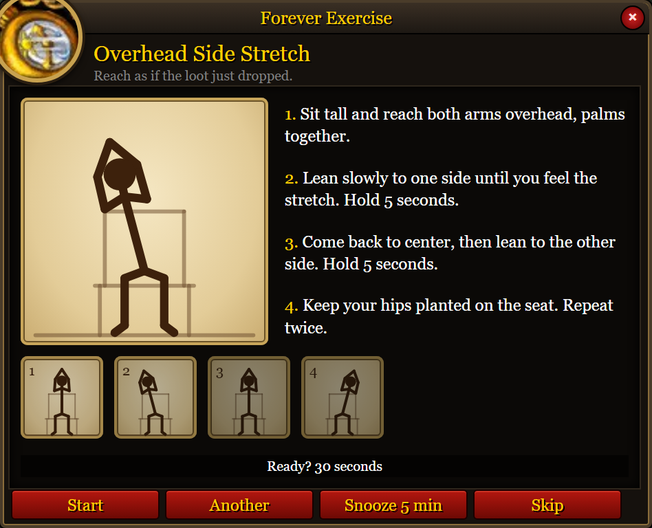
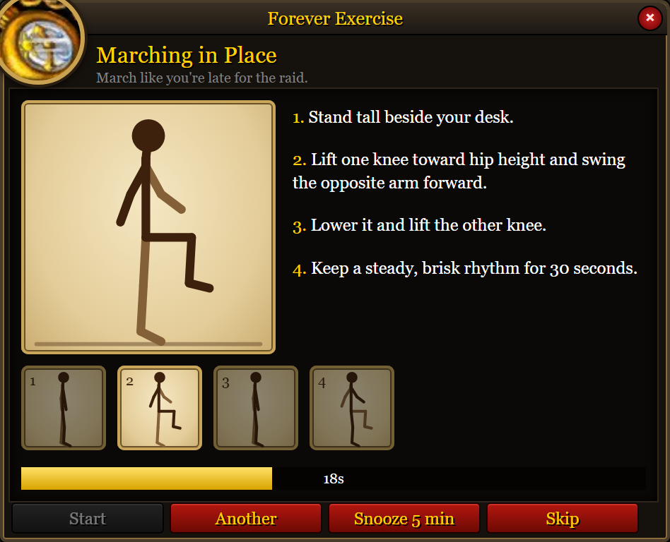
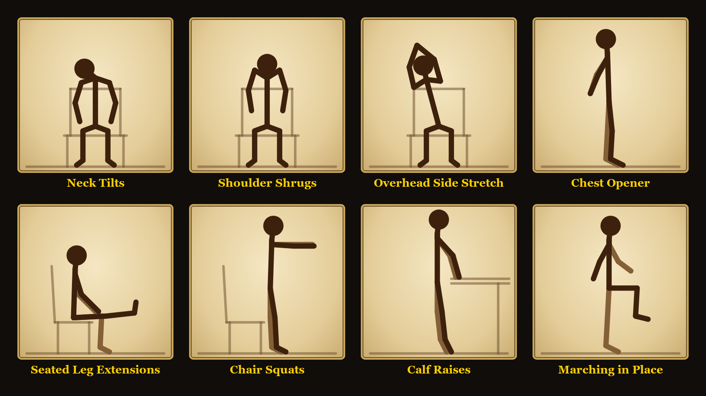
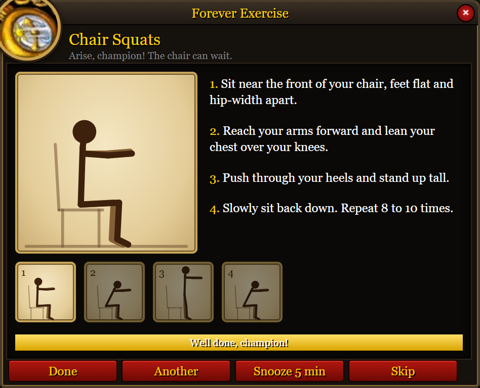

<!--
CurseForge
Paste everything below this comment into the project description, in Markdown.
Upload these four files with the editor's image button and replace each path
with the URL CurseForge gives you:

  screenshots/sideStretch.png
  screenshots/countdown.png
  screenshots/exercises.png
  screenshots/done.png

The other files in screenshots/ are one window per exercise. Those belong in
the project's image gallery, in this order: neck, shrugs, sideStretch,
chestOpener, legExtensions, chairSquats, calfRaises, march, countdown, done.

The release zip should contain the ForeverExercise folder at its root, with
the .toc beside the lua files. Leave screenshots/ and this README out of
that zip.
-->

# Forever Exercise

A reminder to get out of your chair while you play WoW Forever.

Every so often a window opens with one short desk exercise. A figure on the left moves through the poses, and the steps are written on the right. It takes about 30 seconds.

## Playing with it

The timer runs while you are in the game. It begins at 30 minutes, and you can set it anywhere from 5 to 120.

When the window opens:

- **Start** runs the 30 second countdown.
- **Another** swaps in a different exercise.
- **Snooze 5 min** closes the window and asks again in five minutes.
- **Skip**, the close button, or Escape closes it and starts the full interval over.

When the bar fills it says "Well done, champion!" **Done** closes the window.

You see every exercise once before any of them comes around again. The next round starts on a different exercise.

The window closes if you enter combat and opens again when the fight ends. A reminder that comes due during combat waits until you are out of it.

## Minimap button

A pocket watch hangs on the minimap. Hover it for the time until the next exercise. Click it to open the settings. Drag it around the edge of the minimap.

The tooltip also says when the next exercise is snoozed, when the window is waiting until you leave a raid or dungeon, when it is waiting for combat to end, or when it is waiting until you release your spirit. The countdown keeps moving while that window waits.

## Commands

- `/fex` or `/exercise` opens an exercise now.
- `/fex options` or `/fex config` opens the settings.
- During combat, the command tells you to finish the fight first.

## Settings

These are in the game's own settings, under **Forever Exercise**. The minimap button opens them there.

- **Reminder interval.** Minutes of play between reminders. 5 to 120, in steps of 5. The default is 30.
- **Pause exercise notifications in raids.** On by default. The timer keeps running inside a raid, but the window waits until you leave. If it came due inside, it opens once you are back outside.
- **Pause exercise notifications in dungeons.** On by default. The same, for dungeons. Battlegrounds and arenas still open the window on time.
- **Sync timer with group.** On by default. When you join a group or raid, and someone else there is using this addon, you are asked once to match their timer. The question is only on your screen. Turn this off and you are never asked.
- **Exercise when you die.** In the world, a battleground, or an arena. Off by default.
- **Exercise when you die in a dungeon.** Off by default.
- **Exercise when you die in a raid.** Off by default.

Each death option has **Only while you are a ghost** under it, and that line stays grey until the option above it is on. Turn it on and the exercise waits until you release your spirit. The addon remembers where you died, because releasing in a dungeon leaves your ghost outside.

## The exercises

Eight exercises, done in your chair or standing next to it. Nothing to set up. Stop if something hurts.

1. **Neck Tilts.** Even a gryphon looks both ways before landing. Tilt an ear toward one shoulder, then the other.
2. **Shoulder Shrugs.** Shrug off that last wipe. Lift both shoulders toward your ears and let them drop.
3. **Overhead Side Stretch.** Reach as if the loot just dropped. Arms overhead, then a slow lean to each side.
4. **Chest Opener.** Stand proud, champion. Azeroth is watching. Clasp your hands behind your back and lift your chest.
5. **Seated Leg Extensions.** Your legs have been AFK long enough. Straighten one leg, then the other.
6. **Chair Squats.** Arise, champion! The chair can wait. Stand up from the chair, then sit back down.
7. **Calf Raises.** Tiptoe like you're sneaking past an elite. Rise onto the balls of your feet at your desk.
8. **Marching in Place.** March like you're late for the raid. Knees up, at a steady pace, for the full half minute.

## Install

Forever Exercise is for WoW Forever, interface 16001. The text follows your WoW client language (11 languages).

1. Copy the `ForeverExercise` folder into your Forever client's `Interface\AddOns` folder. On the beta client, that is `_classic_beta_\Interface\AddOns`.
2. Leave the folder named `ForeverExercise`.
3. Restart the client, or type `/reload`, and enable the addon if it is off.

## Translations

Translations are done with AI. If you have a better one, send a pull request on [GitHub](https://github.com/omp0815/forever-exercise).

Edit `ForeverExercise/Locales/<code>.lua`, then run `node browser/check.js`.
